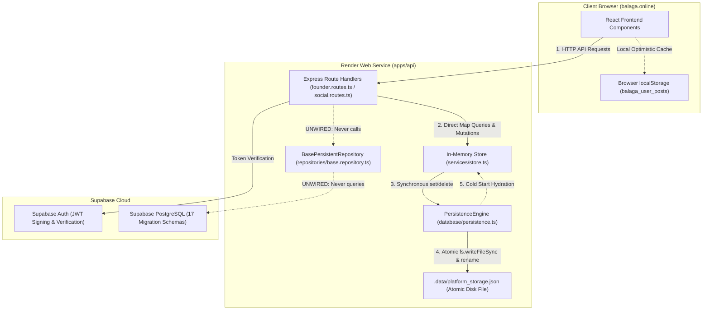

# Balaga — Database Source of Truth & Persistence Architecture Report

**Audit Phase:** Second-Pass Evidence Validation  
**Date:** November 7, 2026  
**Auditor Roles:** Principal Database Architect, Senior Backend Systems Engineer  
**Workspace:** `C:\Users\Manjunath H Annigeri\OneDrive\Desktop\antigravity workspace\platform`  
**Production Domain:** [https://balaga.online](https://balaga.online)  

---

## 1. Executive Ground-Truth Finding

A rigorous trace of the actual execution paths in `apps/api/src/routes/` reveals that **Supabase PostgreSQL is NOT currently the authoritative database for runtime business entity queries in production**.

Instead, the application currently operates on a **Synchronous File-Backed In-Memory Persistence Engine (`PersistentMap` serialized to `.data/platform_storage.json`)**:
1. **Authentication:** Supabase Auth is actively used for token decoding and cryptographic signature verification (`verifySupabaseToken()` in [`apps/api/src/lib/supabase.ts`](file:///C:/Users/Manjunath%20H%20Annigeri/OneDrive/Desktop/antigravity%20workspace/platform/apps/api/src/lib/supabase.ts)).
2. **Business Entities (Posts, Startups, Jobs, Messages, Circles):** Express route handlers in [`founder.routes.ts`](file:///C:/Users/Manjunath%20H%20Annigeri/OneDrive/Desktop/antigravity%20workspace/platform/apps/api/src/routes/founder.routes.ts) and [`social.routes.ts`](file:///C:/Users/Manjunath%20H%20Annigeri/OneDrive/Desktop/antigravity%20workspace/platform/apps/api/src/routes/social.routes.ts) import directly from [`apps/api/src/services/store.ts`](file:///C:/Users/Manjunath%20H%20Annigeri/OneDrive/Desktop/antigravity%20workspace/platform/apps/api/src/services/store.ts), completely bypassing the repository layer ([`apps/api/src/repositories/index.ts`](file:///C:/Users/Manjunath%20H%20Annigeri/OneDrive/Desktop/antigravity%20workspace/platform/apps/api/src/repositories/index.ts)).
3. **Data Persistence Across Restarts:** Data DOES persist across server restarts, but it is hydrated from the local JSON disk snapshot (`.data/platform_storage.json`), NOT from remote PostgreSQL queries.

---

## 2. Actual Production Read & Write Paths



### Trace of Read Operations:
- When a client calls `GET /api/founders/startups`:
  1. Handled by `founderRouter.get("/startups", ...)` in `apps/api/src/routes/founder.routes.ts` line 9496.
  2. Executes: `let list = Array.from(startupsStore.values());`.
  3. Returns records directly from the `startupsStore` map in memory.
  4. **PostgreSQL query executed:** `0` (Supabase is not contacted).

### Trace of Write Operations:
- When a client calls `POST /api/founders/startups`:
  1. Handled by `founderRouter.post("/startups", ...)` in `apps/api/src/routes/founder.routes.ts` line 9557.
  2. Executes: `startupsStore.set(newStartupId, newStartup);`.
  3. `startupsStore` is an instance of `PersistentMap` created by `globalPersistence.registerStore<Startup>("startups")`.
  4. In [`apps/api/src/database/persistence.ts`](file:///C:/Users/Manjunath%20H%20Annigeri/OneDrive/Desktop/antigravity%20workspace/platform/apps/api/src/database/persistence.ts) lines 30-36:
     ```typescript
     set(key: K, value: V): this {
       super.set(key, value);
       if (this.persistenceEngine.isPersisting()) {
         this.persistenceEngine.saveAllSync();
       }
       return this;
     }
     ```
  5. `saveAll()` writes an atomic `.tmp` file and renames it synchronously to `.data/platform_storage.json`.
  6. **PostgreSQL write executed:** `0` (Supabase is not contacted).

---

## 3. Disconnected Repository Layer Analysis

The repository layer was implemented in [`apps/api/src/repositories/base.repository.ts`](file:///C:/Users/Manjunath%20H%20Annigeri/OneDrive/Desktop/antigravity%20workspace/platform/apps/api/src/repositories/base.repository.ts) and instantiated in [`apps/api/src/repositories/index.ts`](file:///C:/Users/Manjunath%20H%20Annigeri/OneDrive/Desktop/antigravity%20workspace/platform/apps/api/src/repositories/index.ts):

```typescript
export const startupsRepository = new BasePersistentRepository<Startup>("startups", startupsStore);
```

However, static analysis confirms:
- **Grep Count:** `0` imports of `repositories` in `apps/api/src/routes/*.ts`.
- The routes were originally built to mutate `store.ts` directly during rapid prototyping. While `BasePersistentRepository` was created to bridge into PostgreSQL, the route handlers were never refactored to call `startupsRepository.create()` or `startupsRepository.findById()`.
- **Consequence:** The PostgreSQL schema exists in `supabase/migrations/`, but the running Express API does not perform SQL queries or inserts against it.

---

## 4. Frontend Persistence & Fallback Dependencies

Inspection of `apps/web/src/features/` shows how client-side state is handled:

1. **Unauthenticated Offline Fallbacks:**
   - In [`FoundersDashboard.tsx`](file:///C:/Users/Manjunath%20H%20Annigeri/OneDrive/Desktop/antigravity%20workspace/platform/apps/web/src/features/founders/FoundersDashboard.tsx) lines 184-211, `fetch("/api/founders/dashboard")` sends `"x-mock-user": "true"`.
   - On the live Render production backend (`NODE_ENV=production`), `x-mock-user` is rejected with `HTTP 401 Unauthorized`.
   - The frontend catches this error and falls back to rendering rich mock starter data seeded in React state (`metrics`, `startups`, `attentionItems`).
2. **Browser `localStorage` Persistence:**
   - In [`SocialFeed.tsx`](file:///C:/Users/Manjunath%20H%20Annigeri/OneDrive/Desktop/antigravity%20workspace/platform/apps/web/src/features/socializing/SocialFeed.tsx), user-created posts are stored in `localStorage` under `balaga_user_posts`.
   - When a user refreshes the page, `localStorage` is loaded into the feed state.
3. **Client-Side Direct Supabase Queries:**
   - The frontend contains **zero** `supabase.from(...)` queries. It relies exclusively on Express API endpoints and local React state.

---

## 5. False-Success Risk & Error Propagation

- **Claim Checked:** Can failed database writes produce false success?
- **Finding:**
  - Because write operations execute against `PersistentMap` and write to disk via `fs.writeFileSync()`:
    - If the disk is full or read-only, `saveAll()` throws an unhandled synchronous I/O exception (`EACCES` or `ENOSPC`), causing the Express request to crash with `HTTP 500`. It does NOT report false success.
    - However, because writes are NOT sent to remote Supabase PostgreSQL, a successful API response (`HTTP 201 Created`) only guarantees disk persistence in the Render container's filesystem—**not replication to Supabase Cloud PostgreSQL**.
  - **Render Ephemeral Disk Limitation:** Render free-tier instances have ephemeral local disks. When Render spins down an idle instance or deploys a new commit, any data written strictly to `.data/platform_storage.json` inside that container will be reset to the git-committed state!

---

## 6. Status & Verdict Summary

| Component / Subsystem | Tested Behavior | Status |
|---|---|---|
| **Supabase Auth JWT** | Decodes token, verifies cryptographic signature via Supabase API or JWT secret | **`VERIFIED`** |
| **Local Disk Persistence** | Atomic write to `.data/platform_storage.json` on every mutation | **`VERIFIED`** |
| **Restart Hydration** | Engine hydronates records from `.data/platform_storage.json` on boot | **`VERIFIED`** |
| **PostgreSQL Runtime Queries** | Route handlers execute SQL queries against Supabase PostgreSQL | **`FAILED`** (Unwired; routes call `store.ts` directly) |
| **Repository Integration** | Routes import and use `repositories/index.ts` | **`FAILED`** (0 references in routes) |
| **Render Ephemeral Resilience** | Data persists across Render container teardown | **`FAILED`** (Requires PostgreSQL database connection) |

### Remediation Path:
To make Supabase PostgreSQL genuinely authoritative in production, the Express route handlers in `founder.routes.ts` and `social.routes.ts` must be refactored to call `*Repository.findById()` and `*Repository.create()` instead of querying in-memory `Map`s directly.
